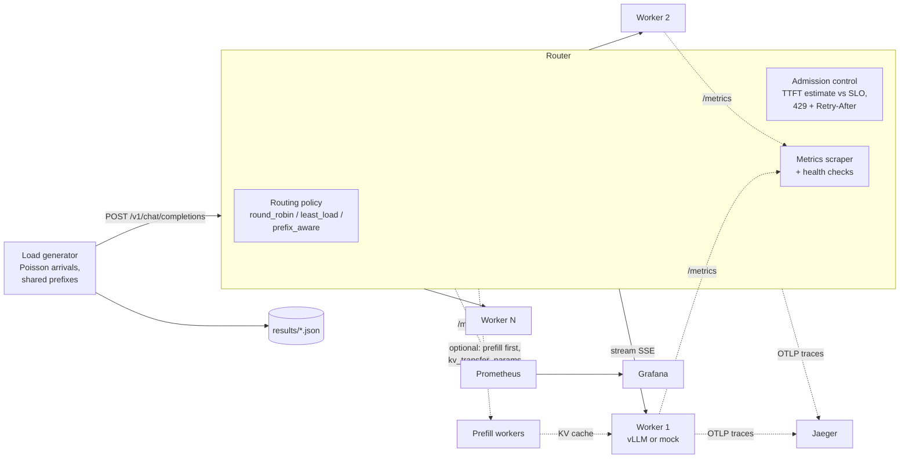

# llmserve

A distributed LLM serving platform: an OpenAI-compatible router in front of
multiple vLLM workers, with smart routing, overload protection and a benchmark
harness that compares each improvement against a naive round-robin baseline.

Status: **Phases 1 to 6 done** (baseline, smart routing, overload protection, Kubernetes, observability, disaggregated prefill/decode). See [docs/K8S.md](docs/K8S.md) and [docs/OBSERVABILITY.md](docs/OBSERVABILITY.md). See [docs/PLAN.md](docs/PLAN.md) for the phase plan and
which parts need a real NVIDIA GPU, and [RESULTS.md](RESULTS.md) for measured numbers.

## Architecture



- **Router** (`src/llmserve/router`): FastAPI proxy. Picks a worker per request
  through a pluggable `Policy`, relays streaming responses token by token, and tags
  each response with `x-llmserve-worker` so benchmarks can see where requests went.
- **Workers**: real `vllm serve` on NVIDIA GPUs, or the **mock worker**
  (`src/llmserve/mock_worker`) on machines without one. The mock speaks the same API
  and exposes the same Prometheus metric names, and simulates batching slowdown, a
  bounded KV cache and a block-level prefix cache.
- **Load generator** (`src/llmserve/bench`): open-loop Poisson arrivals, a few long
  shared system prompts (Zipf popularity) plus lognormal user and output lengths.
  Reports throughput, p50/p95/p99 latency, TTFT, TPOT and peak GPU memory, and saves
  the full config, hardware, commit hash and every request sample to JSON.

## Design decisions

- **Open-loop load, not closed-loop.** A closed-loop client waits for replies before
  sending more, which hides overload. Poisson arrivals at a fixed rate show queueing
  delay the way real users experience it.
- **Shared system-prompt prefixes in the workload.** Production chat traffic reuses
  a few long system prompts. This is what later makes prefix-aware routing measurable.
- **Routing signals: router inflight + vLLM queue depth + KV-cache usage.** The router's own
  inflight count is always fresh; scraped `num_requests_waiting` catches load from other
  routers; `gpu_cache_usage_perc` near 1.0 means vLLM must queue or preempt even with a short
  queue. Scrapes run every 250 ms, so the fresh local signal covers the gap between scrapes.
- **Prefix-aware = rendezvous hashing + load, not hashing alone.** Each shared prefix (first
  512 chars) gets a stable home worker via rendezvous hashing (only the dead worker's prefixes
  move on failure). The home only gets a bonus worth 2 load units. A first version used a
  bounded-load cap and let popular prefixes pile up: more cache hits, much worse TTFT near
  saturation (see RESULTS.md). The lesson: cache locality is only worth it while it doesn't
  create queueing.
- **Admission control on estimated TTFT, not a fixed concurrency cap.** A fixed cap has to be
  tuned per model and GPU. Instead the router estimates queueing delay from the requests ahead,
  the worker's learned slot count, and an EWMA of service time, and rejects with 429 +
  Retry-After only when no worker can meet the SLO. TTFT is the target because queueing shows
  up there directly; total latency also includes decode time, which depends on how many tokens
  the client asked for. Shedding early keeps served throughput at capacity while admitted
  requests stay fast; queueing everything makes every user slow (see RESULTS.md, Phase 3).
- **Failover only before the first byte.** Connection and read errors before any response is
  sent are retried on another worker and the worker is marked unhealthy at once; the scraper
  doubles as an active health check (2 failed scrapes = unhealthy, 1 success = healthy again).
  Once tokens have streamed to the client, a retry would duplicate output, so the stream ends
  with an error event instead.
- **Kubernetes: DNS discovery + KEDA on queue depth.** Workers sit behind a headless Service
  that the router re-resolves every 2 s, so autoscaling needs no router restart. KEDA scales on
  the router's queue-depth signal, not GPU utilisation: vLLM keeps the GPU busy even at light
  load, and queue depth is what users feel as latency. KubeRay is provided for GPU clusters
  (Ray handles GPU placement and node autoscaling); the plain-Deployment overlay is the simpler option.
- **Observability: metrics on decisions, traces on stages.** Prometheus counters record *why*
  each request went where it did (policy, admission redirect, failover) and how it ended;
  histograms give TTFT and latency percentiles. Traces answer "where did this slow request
  spend its time?": router spans plus worker queue/prefill/decode spans in one trace via W3C
  `traceparent`, which vLLM's own tracing also reads.
- **Disaggregated prefill/decode speaks vLLM's protocol.** With `--prefill-workers`, the router
  sends each request to a prefill worker first (`max_tokens=1`, `kv_transfer_params.do_remote_decode`),
  then forwards the returned `kv_transfer_params` to a decode worker that streams the answer. This is
  the protocol vLLM's NixlConnector proxy uses, so the same code drives mock and real workers.
  Prefill workers are chosen prefix-aware (that's where the prefix cache lives); decode workers by
  load. On the mock it only paid off for prefill-heavy traffic and cost TTFT (see RESULTS.md, Phase 6).
- **Mock worker instead of skipping tests.** The development machine has no NVIDIA
  GPU, so routing and admission logic is developed against a simulator that exposes
  vLLM's metric names. The router doesn't know which backend it's talking to. Mock
  results are labelled `mock` and never presented as GPU numbers.

## Reproduce

Requires [uv](https://docs.astral.sh/uv/).

```bash
uv sync
uv run pytest
```

Local baseline on mock workers (terminal 1, then terminal 2):

```bash
uv run python scripts/run_local.py --workers 4 --policy round_robin
```

```bash
uv run python -m llmserve.bench.loadgen --rps 15 --duration 60 --label phase1-rr-mock --policy round_robin --backend mock
```

Compare all routing policies on the same workload (about 3.5 min per config):

```bash
RPS=22 PREFIXES=64 TAG=64prefix-22rps ./scripts/compare_policies.sh
```

```bash
uv run python scripts/report.py results/phase2-64prefix-22rps-round_robin-*.json results/phase2-64prefix-22rps-least_load-*.json results/phase2-64prefix-22rps-prefix_aware-*.json
```

Kubernetes on kind (KEDA autoscaling demo):

```bash
./scripts/kind_up.sh
```

```bash
uv run python scripts/k8s_autoscale_demo.py --rps 25 --duration 120 --cooldown 120
```

Observability stack (router, mock workers, Prometheus, Grafana on :3000, Jaeger on :16686):

```bash
docker compose -f deploy/observability/docker-compose.yml up -d --build
```

Colocated vs disaggregated prefill/decode (prefill-heavy workload):

```bash
PREFIXES=100000 TAG=unique-prompts CONFIGS="colocated-4w:4:0 disagg-1p3d:3:1" ./scripts/disagg_bench.sh
```

Overload and failover benchmarks:

```bash
RPS=44 SLO=500 ./scripts/overload_bench.sh
```

```bash
RPS=15 KILL_AT=20 ./scripts/failover_bench.sh
```

On an NVIDIA GPU machine:

```bash
N=4 MODEL=Qwen/Qwen2.5-1.5B-Instruct ./scripts/gpu/start_vllm_workers.sh
uv run python -m llmserve.router --workers http://127.0.0.1:8001,http://127.0.0.1:8002,http://127.0.0.1:8003,http://127.0.0.1:8004 --policy round_robin
uv run python -m llmserve.bench.loadgen --model Qwen/Qwen2.5-1.5B-Instruct --backend vllm --rps 15 --duration 60 --label phase1-rr-vllm --policy round_robin
```
