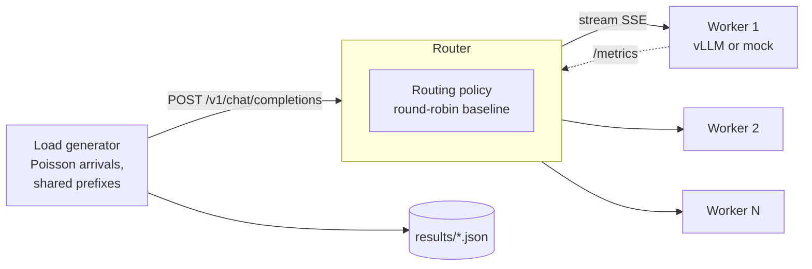

# llmserve

A distributed LLM serving platform: an OpenAI-compatible router in front of
multiple vLLM workers, with smart routing, overload protection and a benchmark
harness that compares each improvement against a naive round-robin baseline.

Status: **Phase 1 (baseline) done.** See [docs/PLAN.md](docs/PLAN.md) for the phase plan and
which parts need a real NVIDIA GPU, and [RESULTS.md](RESULTS.md) for measured numbers.

## Architecture



- **Router** (`src/llmserve/router`): FastAPI proxy. Picks a worker per request
  through a pluggable `Policy`, relays streaming responses token by token, and tags
  each response with `x-llmserve-worker` so benchmarks can see where requests went.
- **Workers**: real `vllm serve` on NVIDIA GPUs, or the **mock worker**
  (`src/llmserve/mock_worker`) on machines without one. The mock speaks the same API
  and exposes the same Prometheus metric names, and simulates batching slowdown, a
  bounded KV cache and a block-level prefix cache.
- **Load generator** (`src/llmserve/bench`): open-loop Poisson arrivals, a few long
  shared system prompts (Zipf popularity) plus lognormal user and output lengths.
  Reports throughput, p50/p95/p99 latency, TTFT, TPOT and peak GPU memory, and saves
  the full config, hardware, commit hash and every request sample to JSON.

## Design decisions

- **Open-loop load, not closed-loop.** A closed-loop client waits for replies before
  sending more, which hides overload. Poisson arrivals at a fixed rate show queueing
  delay the way real users experience it.
- **Shared system-prompt prefixes in the workload.** Production chat traffic reuses
  a few long system prompts. This is what later makes prefix-aware routing measurable.
- **Mock worker instead of skipping tests.** The development machine has no NVIDIA
  GPU, so routing and admission logic is developed against a simulator that exposes
  vLLM's metric names. The router doesn't know which backend it's talking to. Mock
  results are labelled `mock` and never presented as GPU numbers.

## Reproduce

Requires [uv](https://docs.astral.sh/uv/).

```bash
uv sync
uv run pytest
```

Local baseline on mock workers (terminal 1, then terminal 2):

```bash
uv run python scripts/run_local.py --workers 4 --policy round_robin
```

```bash
uv run python -m llmserve.bench.loadgen --rps 15 --duration 60 --label phase1-rr-mock --policy round_robin --backend mock
```

On an NVIDIA GPU machine:

```bash
N=4 MODEL=Qwen/Qwen2.5-1.5B-Instruct ./scripts/gpu/start_vllm_workers.sh
uv run python -m llmserve.router --workers http://127.0.0.1:8001,http://127.0.0.1:8002,http://127.0.0.1:8003,http://127.0.0.1:8004 --policy round_robin
uv run python -m llmserve.bench.loadgen --model Qwen/Qwen2.5-1.5B-Instruct --backend vllm --rps 15 --duration 60 --label phase1-rr-vllm --policy round_robin
```
