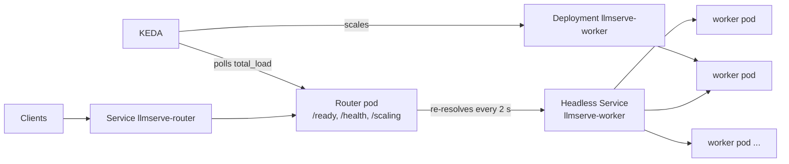

# Kubernetes deployment

```
deploy/
  k8s/base/              router + worker Deployments, headless worker Service, probes, KEDA ScaledObject
  k8s/overlays/kind/     local: mock workers, locally built image
  k8s/overlays/gpu/      real cluster: vLLM workers, 1 GPU per pod
  kuberay/               RayCluster + script for running vLLM replicas under Ray
```

## How the pieces connect



- **Worker discovery**: the headless Service returns one DNS record per *ready* worker pod.
  The router re-resolves it every 2 s (`--worker-dns`), so scale-ups, scale-downs and pod
  restarts need no router restart.
- **Probes**: workers use `/health` for readiness and liveness (GPU overlay adds a startup probe
  that allows 10 min for model download and load). The router's readiness is `/ready`, which
  returns 503 until at least one worker is healthy, so it gets no traffic before it can serve.
- **Autoscaling on queue depth**: KEDA's `metrics-api` scaler polls the router's `/scaling`
  endpoint every 5 s. `total_load` = requests in flight through the router plus vLLM's own
  waiting queue. Desired replicas = `ceil(total_load / targetValue)` (12 for mock workers, 64 for
  vLLM, which batches far more sequences). Scale-down waits 60 s to avoid flapping.
  Queue depth is used instead of GPU utilisation because a GPU running vLLM shows high
  utilisation even at light load; queue depth is what turns into user-visible latency.

## Local (kind)

Requires Docker, kubectl, [kind](https://kind.sigs.k8s.io) and [helm](https://helm.sh).

```bash
./scripts/kind_up.sh
```

```bash
uv run python scripts/k8s_autoscale_demo.py --rps 25 --duration 120 --cooldown 120
```

```bash
kind delete cluster --name llmserve
```

`kind_up.sh` installs KEDA and the KubeRay operator. The RayCluster manifest is checked with
`kubectl apply --dry-run=server` against the real CRD; no Ray pods start, because the Ray GPU
image is ~10 GB and the local Docker VM has 4 GB of memory.

## Real multi-GPU cluster

These steps were **not run** for this project (no NVIDIA GPUs were available). They're the
intended path, using standard components.

1. **Cluster with GPU nodes** (EKS, GKE, AKS or on-prem) with the
   [NVIDIA GPU Operator](https://docs.nvidia.com/datacenter/cloud-native/gpu-operator/latest/)
   or device plugin installed, so pods can request `nvidia.com/gpu`.
2. **Push the router image** and set it in `deploy/k8s/overlays/gpu/kustomization.yaml`:
   ```bash
   docker build -t ghcr.io/YOUR_USER/llmserve:latest . && docker push ghcr.io/YOUR_USER/llmserve:latest
   ```
3. **Install KEDA**:
   ```bash
   helm upgrade --install keda kedacore/keda -n keda --create-namespace
   ```
4. **Option A: plain Deployments (simplest).** One vLLM pod per GPU, scaled by KEDA:
   ```bash
   kubectl apply -k deploy/k8s/overlays/gpu
   ```
5. **Option B: KubeRay.** Ray owns GPU scheduling and node autoscaling:
   ```bash
   helm upgrade --install kuberay-operator kuberay/kuberay-operator -n kuberay --create-namespace
   kubectl apply -f deploy/kuberay/raycluster-vllm.yaml
   kubectl -n llmserve exec -it deploy/llmserve-vllm-head -- python serve_workers.py --replicas 4
   ```
   Then point the router at `--worker-dns=llmserve-ray-workers:8001` and remove the base worker
   Deployment. Replica count is set by `serve_workers.py`; the Ray autoscaler adds GPU pods to fit.
6. **Benchmark** from inside the cluster (port-forwarding adds latency):
   ```bash
   kubectl -n llmserve run loadgen --rm -it --image=ghcr.io/YOUR_USER/llmserve:latest -- \
     llmserve.bench.loadgen --url http://llmserve-router:8000 --backend vllm \
     --model Qwen/Qwen2.5-1.5B-Instruct --rps 20 --duration 120 --label phase4-gpu-cluster
   ```
   Copy the result out with `kubectl cp` and add it to `results/`.

Tuning notes for real GPUs: raise `--default-slots` to vLLM's real concurrency (it is also learned
from metrics), set `targetValue` from a measured saturation point, and give the router more replicas
behind the Service if a single router becomes the bottleneck.
