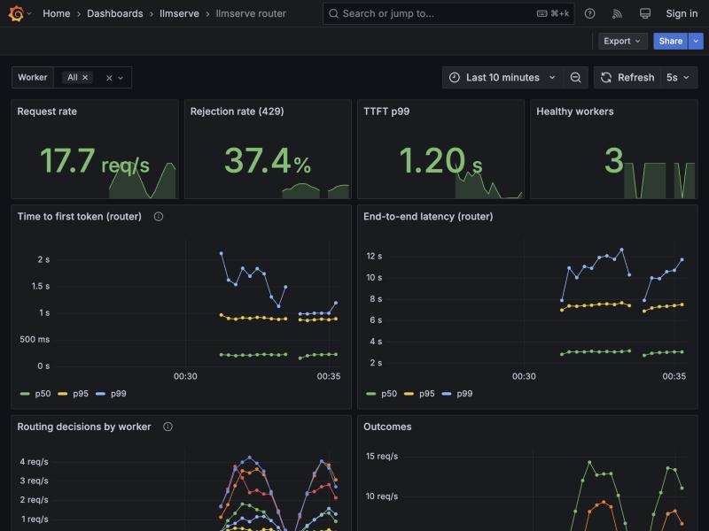

# Observability



*Mock workers on Apple M3: traffic at 22 RPS into 3 workers, with worker-2 stopped for 20 s.*

## Run it

```bash
docker compose -f deploy/observability/docker-compose.yml up -d --build
```

```bash
uv run python -m llmserve.bench.loadgen --rps 22 --duration 90 --label obs-demo --out-dir logs
```

- Grafana: http://localhost:3000 (the dashboard opens as the home page; anonymous viewer)
- Prometheus: http://localhost:9090
- Jaeger (traces): http://localhost:16686, service `llmserve-router`

```bash
docker compose -f deploy/observability/docker-compose.yml down
```

## Router metrics (`GET /metrics`)

| Metric | Type | Labels | Meaning |
|---|---|---|---|
| `llmserve_requests_total` | counter | worker, code | Requests by outcome (200, 429, 502, 503, stream_error) |
| `llmserve_routing_decisions_total` | counter | policy, worker, reason | Where each request went; reason = `policy`, `admission_redirect` or `failover` |
| `llmserve_admission_rejections_total` | counter | | Requests shed with 429 |
| `llmserve_worker_failures_total` | counter | worker, stage | Worker failures at `connect` (retried) or mid-`stream` |
| `llmserve_ttft_seconds` | histogram | worker | Time to first token through the router |
| `llmserve_request_latency_seconds` | histogram | worker | End-to-end latency |
| `llmserve_worker_inflight` | gauge | worker | Requests this router has open on the worker |
| `llmserve_worker_queue_waiting` / `_running` | gauge | worker | vLLM's own queue (scraped) |
| `llmserve_worker_kv_cache_usage` | gauge | worker | vLLM KV-cache usage 0..1 (scraped) |
| `llmserve_worker_healthy` | gauge | worker | Health-check state |
| `llmserve_worker_est_ttft_seconds` | gauge | worker | Admission controller's current TTFT estimate |

Per-worker gauges are computed at scrape time from the router's live worker table, so they cost
nothing on the request path. Workers expose vLLM's native metrics too (the mock uses the same
names), and Prometheus scrapes them directly for the prefix-cache hit-rate panel.

## Traces

The router propagates W3C `traceparent` to workers, so one request is one trace across services:

```
llmserve.request         router    whole request
  route                  router    policy + admission decision (worker, reason, est_ttft_ms)
  upstream               router    connect -> last byte
    wait_first_token     router    queueing + prefill as the router sees it
    stream               router    decode as the router sees it
    worker.request       worker
      worker.queue       worker    waiting for a batch slot / KV space
      worker.prefill     worker    prompt_tokens, prefix_cache_hit_tokens
      worker.decode      worker
```

Example from Jaeger (mock worker): `route` 0.1 ms, `wait_first_token` 45 ms (`worker.queue`
0.0 ms + `worker.prefill` 15 ms), `stream` 2029 ms (`worker.decode` 2054 ms).

With real vLLM, the worker-side spans come from vLLM itself: start it with
`--otlp-traces-endpoint=http://<collector>:4318/v1/traces` and it reads the same `traceparent`,
reporting queue time, TTFT and decode per request as span attributes.

Export is enabled by setting `OTEL_EXPORTER_OTLP_ENDPOINT` (OTLP/HTTP). Without it, spans are
dropped at no cost. FastAPI's built-in per-endpoint spans are switched off so health checks and
metrics scrapes don't flood the trace store.

## Dashboard

`deploy/grafana/llmserve-dashboard.json` is generated by `scripts/gen_dashboard.py`. Panels:
request rate, rejection rate, TTFT p99, healthy workers; TTFT and latency p50/p95/p99; routing
decisions by worker and reason; outcomes; per-worker inflight, vLLM queue, KV cache and admission
estimate; worker failures; prefix-cache hit rate per worker. A `worker` variable filters panels.
Import it into any Grafana with a Prometheus datasource whose uid is `prometheus`.
